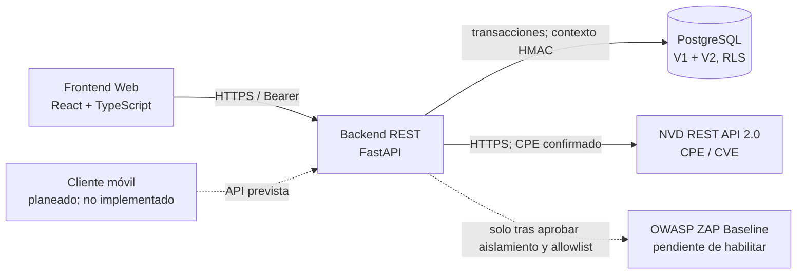

# Reporte Final del Proyecto: VulnTrack

> **Estado del documento:** borrador técnico basado en los cuatro repositorios sincronizados en la rama `rudi` al 22/11/2026. Los datos sin evidencia se marcan como pendientes; no se presumen despliegues, pruebas o decisiones que no estén registrados.

## Ficha de Identificación

* **Institución:** Universidad Politécnica de Chiapas
* **Carrera / Programa:** Ingeniería en Tecnologías de la Información e Innovación Digital
* **Asignatura:** Seguridad Informática
* **Profesor:** M.C. José Alonso Macías Montoya
* **Fecha de Entrega:** **PENDIENTE** de confirmar
* **Nombre del Equipo / Grupo:** **PENDIENTE** de confirmar
* **Nombre del Proyecto:** VulnTrack

### Integrantes del Equipo

| Nombre Completo | Matrícula | Correo Electrónico | Rol / Enfoque Principal |
| ----- | ----- | ----- | ----- |
| **PENDIENTE** | **PENDIENTE** | **PENDIENTE** | **PENDIENTE** |
| **PENDIENTE** | **PENDIENTE** | **PENDIENTE** | **PENDIENTE** |

El contexto consultado registra un equipo de dos desarrolladores; los nombres, matrículas, correos y asignación de responsabilidades no están documentados. No se completa esta ficha con nombres inferidos de autores de Git.

## Sección I: Control de Acceso y Enlaces del Proyecto

| Recurso | Enlace / Estado | Notas de Acceso |
| ----- | ----- | ----- |
| **Repositorio de código fuente — Backend** | [vuln-track-backend](https://github.com/Jesel8D/vuln-track-backend) | Se consultó `origin/rudi` mediante Git el 22/11/2026. **PENDIENTE:** confirmar visibilidad y acceso docente. |
| **Repositorio de código fuente — Frontend Web** | [vuln-track-frontend](https://github.com/Jesel8D/vuln-track-frontend) | Se consultó `origin/rudi` mediante Git el 22/11/2026. **PENDIENTE:** confirmar visibilidad y acceso docente. |
| **Repositorio de base de datos** | [vuln-track-database](https://github.com/Jesel8D/vuln-track-database) | Se consultó `origin/rudi` mediante Git el 22/11/2026. **PENDIENTE:** confirmar visibilidad y acceso docente. |
| **Repositorio de contexto y documentación** | [vuln-track-context](https://github.com/Jesel8D/vuln-track-context) | Repositorio de documentación compartida; se consultó `origin/rudi` mediante Git el 22/11/2026. **PENDIENTE:** confirmar visibilidad y acceso docente. |
| **Aplicación Web / despliegue API** | **No hay despliegue publicado documentado** | Desarrollo local previsto; no se encontró URL de producción/demo. |
| **Video demostrativo (3–5 min)** | **PENDIENTE** | No se encontró un enlace en los repositorios. |

La consulta Git actualizó las referencias remotas. Los cuatro repositorios estaban en `rudi`, sincronizados con `origin/rudi`, sin commits locales pendientes ni commits remotos pendientes de bajar.

## Sección II: Declaración de Licencia de Software

### 2.1 Tipo de Licencia Seleccionada

**PENDIENTE:** no se encontró archivo `LICENSE` en la raíz de los repositorios de aplicación. No se debe presentar el proyecto como MIT, Apache, GPL u otra licencia hasta que el equipo la seleccione y agregue los avisos necesarios.

### 2.2 Justificación de la Licencia

**PENDIENTE:** requiere decisión explícita del equipo. La ausencia de un archivo de licencia no determina automáticamente que el software sea de dominio público ni que pueda redistribuirse bajo una licencia particular.

## Sección III: Resumen Ejecutivo y Planteamiento

### 3.1 Descripción del Proyecto

VulnTrack es una plataforma académica para registrar y administrar aplicaciones web y sus tecnologías, consultar vulnerabilidades conocidas en la National Vulnerability Database (NVD) a partir de productos CPE confirmados por una persona, revisar hallazgos potenciales y dar seguimiento manual a recomendaciones. El sistema se organiza como frontend web React/TypeScript, API FastAPI y PostgreSQL. El backend concentra autenticación, autorización, consultas externas y persistencia.

La prioridad de producto también contempla un cliente móvil para registrar activos desde campo. **A la fecha de este reporte no se encontró un repositorio ni una implementación móvil entre los cuatro repositorios entregados.** La vista OWASP ZAP Baseline está integrada en el frontend web como interfaz de estado, pero la ejecución desde backend sigue deshabilitada mientras se resuelven sus controles de seguridad.

### 3.2 Planteamiento del Problema y Justificación

Los equipos pueden tener dificultades para mantener un inventario de aplicaciones y tecnologías, relacionar versiones con vulnerabilidades conocidas y seguir su corrección. VulnTrack busca reunir esos datos y conservar la procedencia de las consultas, facilitando la revisión sin afirmar que una coincidencia NVD demuestra que un sistema es vulnerable.

NVD no inspecciona un enlace de aplicación o repositorio para descubrir sus componentes. El flujo requiere identificar producto y versión, buscar candidatos CPE, confirmar el CPE y después consultar CVE. Un escaneo web con ZAP es un proceso separado. La solución limita su alcance a resultados informativos y verificables por una persona, apropiados para un proyecto académico.

### 3.3 Matriz de Cumplimiento de Objetivos

| Objetivo Inicial Planteado | Estado de Implementación | Observaciones / Alcance Logrado |
| ----- | ----- | ----- |
| **General:** construir una plataforma web y móvil para inventariar aplicaciones/activos, consultar vulnerabilidades y apoyar análisis de seguridad controlados. | Parcial | Hay aplicación web, API, modelo V2 de workspaces/aplicaciones y consultas NVD. No se encontró implementación del cliente móvil. ZAP no ejecuta escaneos todavía. |
| **Específico 1:** diseñar arquitectura, modelo de datos y API. | Parcial | Se documentó e implementó una base PostgreSQL V1/V2, API FastAPI con rutas V1 y V2, acceso por workspaces y una integración NVD. El contrato y la arquitectura general conservan decisiones pendientes indicadas en el contexto. |
| **Específico 2:** desarrollar interfaces para administrar y consultar información. | Parcial | La web incluye dashboard, inventario de aplicaciones, tecnologías/CPE, historial NVD, revisión de hallazgos, recomendaciones y vista de análisis ZAP bloqueada. No se encontró cliente móvil. |
| **Específico 3:** aplicar seguridad y realizar pruebas de seguridad. | Parcial | Hay controles de autenticación, autorización por workspace/RLS, HMAC, validación, límites y persistencia. La documentación contiene revisiones de seguridad. No hay evidencia de una prueba de penetración integral ni de un escaneo ZAP ejecutado; esos resultados no se declaran. |

## Sección IV: Arquitectura Técnica y Stack Tecnológico

### 4.1 Stack Tecnológico

* **Frontend Web:** React 19, TypeScript, Vite, React Router, TanStack Query y Lucide React; CSS del proyecto.
* **Frontend Móvil:** contemplado como aplicación separada; React Native + Expo + TypeScript aparece como propuesta en documentos de contexto. No se encontró código móvil en los repositorios revisados.
* **Backend & API:** Python 3.12, FastAPI, SQLAlchemy, Alembic y servidor ASGI Uvicorn (según manifiestos y documentación del backend).
* **Base de Datos:** PostgreSQL 16 en los archivos de configuración y documentación de desarrollo, con SQL de bootstrap V1/V2 y migraciones backend. El esquema completo contempla 5 tablas V1, 10 tablas de dominio V2 y 1 tabla privada para claves de contexto (16 en conjunto, contando el esquema privado).
* **Infraestructura & Contenedores:** Docker Compose se contempla para PostgreSQL local. Docker para aislar un ejecutor ZAP es una propuesta pendiente; no hay escáner ZAP conectado.
* **Seguridad / Criptografía:** Argon2id para hashes de contraseña; JWT firmado HS256 para autenticación; HMAC-SHA256 para el contexto de workspace; TLS exigido para uso remoto según documentación. No se almacena una contraseña predeterminada en el código de aprovisionamiento.
* **Integración externa:** NVD Products/CPE API y Vulnerabilities/CVE API 2.0 desde el backend.

No se encontró archivo de licencia del proyecto ni configuración de despliegue web/API en los repositorios de producto.

### 4.2 Diagrama de Arquitectura de la Solución

El frontend no se conecta directamente a PostgreSQL ni contiene la clave NVD. El backend es el único componente que consulta NVD. ZAP no está habilitado, y la conexión punteada del diagrama representa una integración futura, no una capacidad operativa actual.

### 4.3 Especificación de Endpoints Principales de la API

Todas las rutas listadas son REST. Las rutas protegidas requieren `Authorization: Bearer <JWT>`, salvo las marcadas como públicas. V2 además requiere que el usuario pertenezca al workspace y que la operación cumpla su rol.

| Método HTTP | Ruta / Endpoint | Descripción | Requiere Autenticación |
| ----- | ----- | ----- | ----- |
| `POST` | `/api/v1/auth/login` | Autentica usuario/contraseña y emite JWT. | No |
| `GET` | `/api/v1/auth/me` | Devuelve identidad autenticada actual. | Sí |
| `GET/POST` | `/api/v2/workspaces` | Lista workspaces accesibles o crea el primero con clave de idempotencia. | Sí |
| `GET/POST` | `/api/v2/workspaces/{workspace_id}/applications` | Lista o registra aplicaciones web. | Sí; rol según operación |
| `GET/POST` | `/api/v2/workspaces/{workspace_id}/applications/{application_id}/technologies` | Consulta o registra tecnologías y versiones. | Sí; rol según operación |
| `GET` | `/api/v2/workspaces/{workspace_id}/applications/{application_id}/cpe-candidates` | Busca candidatos en el catálogo de productos CPE de NVD. | Sí |
| `PUT` | `/api/v2/workspaces/{workspace_id}/applications/{application_id}/technologies/{technology_id}/cpe` | Resuelve el candidato con NVD y guarda CPE tras selección/confirmación humana. | Sí; rol de escritura |
| `POST` | `/api/v2/workspaces/{workspace_id}/applications/{application_id}/technologies/{technology_id}/analyses` | Solicita consulta CVE para una tecnología con CPE confirmado; usa `Idempotency-Key`. | Sí; rol de escritura |
| `GET` | `/api/v2/workspaces/{workspace_id}/applications/{application_id}/analyses` y `.../analyses/{run_id}` | Consulta historial y estado de ejecuciones NVD. | Sí |
| `GET` | `/api/v2/workspaces/{workspace_id}/applications/{application_id}/analyses/{run_id}/findings` | Lista hallazgos paginados de una consulta. | Sí |
| `PATCH` | `/api/v2/workspaces/{workspace_id}/applications/{application_id}/findings/{finding_id}` | Registra revisión humana de aplicabilidad con control de concurrencia. | Sí; rol de escritura |
| `GET/POST` | `/api/v2/workspaces/{workspace_id}/applications/{application_id}/findings/{finding_id}/recommendations` | Consulta o agrega una recomendación de seguimiento manual. | Sí; rol según operación |
| `PATCH` | `/api/v2/workspaces/{workspace_id}/applications/{application_id}/recommendations/{recommendation_id}` | Actualiza estado de una recomendación. | Sí; rol de escritura |
| `GET/POST` | `/api/v2/workspaces/{workspace_id}/applications/{application_id}/targets` | Lista o registra URLs; el alta no inicia análisis ni autoriza automáticamente el destino. | Sí; rol según operación |
| `GET` | `/api/v2/workspaces/{workspace_id}/targets` | Lista destinos de las aplicaciones del workspace con estado de autorización. | Sí |
| `PATCH` | `/api/v2/workspaces/{workspace_id}/applications/{application_id}/targets/{target_id}/authorization` | Registra/revoca una declaración con referencia y vigencia limitada. No habilita por sí sola ZAP. | Sí; rol de escritura |
| `GET` | `/api/v2/workspaces/{workspace_id}/dashboard` | Devuelve resumen, tendencias, consultas recientes y hallazgos prioritarios. | Sí |

El backend conserva también rutas V1 para activos/dispositivos, CPE y ejecuciones históricas. No existe una ruta de alta pública de usuarios: las cuentas se aprovisionan explícitamente por un responsable mediante script local. No se encontró endpoint ejecutable de ZAP.

## Sección V: Matriz de Seguridad y Evidencias de Funcionamiento

### 5.1 Mecanismos de Seguridad Implementados

* **Autenticación:** login con Argon2id, respuesta genérica ante credenciales inválidas y JWT HS256 con validaciones de firma, audiencia, emisor, expiración y versión del usuario. El JWT tiene duración máxima documentada de 15 minutos. El registro público está deshabilitado; el alta es por aprovisionamiento local controlado.
* **Límite de intentos:** limitador local de intentos de login. Su estado no se comparte entre réplicas y no equivale a una política distribuida de alta escala.
* **Autorización V2:** membresías y roles por workspace; consultas verifican pertenencia y nivel requerido. PostgreSQL aplica RLS en las entidades V2.
* **Contexto de workspace:** el backend firma un contexto de transacción con HMAC-SHA256; la base lo valida y expira. Las claves se provisionan por fuera de Git y no desde el cliente.
* **Validación de entradas y consultas:** parámetros SQL se envían parametrizados; contratos limitan longitudes, enumera estados y paginación. Se emplea control de idempotencia y concurrencia optimista en flujos pertinentes.
* **Integración NVD:** origen fijo HTTPS, sin aceptar URLs de destino del cliente, con timeouts, límites de cuerpo, validación de respuesta y manejo de cobertura parcial. Una consulta recupera hasta 100 CVE en esta iteración; si NVD informa más, el resultado queda marcado parcial.
* **Minimización de datos:** no se almacenan credenciales de clientes ni contraseñas administrativas de los objetivos. Las recomendaciones son manuales; no reparan sistemas.
* **ZAP y SSRF:** el modelo y la interfaz no permiten que el usuario inicie un escaneo ZAP actualmente. Falta implementar y verificar allowlist, autorización vigente, validación DNS en conexión/redirección, bloqueo de redes internas y aislamiento/egreso del ejecutor. No se presenta ZAP como una mitigación ya implementada.
* **Cifrado en reposo:** no hay evidencia revisada de cifrado administrado de volúmenes o campos en reposo; queda pendiente de definir para cualquier despliegue.

Estos mecanismos reflejan el código y documentación inspeccionados. No equivalen a una certificación de seguridad ni a una prueba de penetración integral.

### 5.2 Evidencias de Funcionamiento (Capturas de Pantalla)

#### Interfaz de Usuario (Frontend)

El repositorio contiene vistas de dashboard, aplicaciones, detalle de aplicación, historial NVD y análisis ZAP con ejecución bloqueada. Las imágenes de diseño proporcionadas sirven como referencia visual, no como evidencia de ejecución. **PENDIENTE:** capturar la aplicación corriendo con backend/base de datos y datos de demostración identificados como sintéticos.

#### Peticiones y Respuestas de la API

**PENDIENTE:** anexar capturas de Swagger/OpenAPI o cliente HTTP con solicitudes y respuestas saneadas. No incluir JWT, contraseñas, claves NVD/HMAC, URLs privadas ni datos personales.

#### Pruebas de Seguridad / Análisis

La carpeta `vuln-track-database/docs` incluye revisión de seguridad V1 y documentos de evaluación del modelo V2. El backend documenta autenticación y controles de acceso, y el frontend pasó `npm run lint` y `npm run build` en la integración reciente de la vista ZAP. También se ejecutó `python -m compileall` para el módulo del dashboard durante su integración.

**Limitación de evidencia:** en esta actualización no se pudieron iniciar ni verificar Docker Engine ni un backend local, así que no se hizo una comprobación funcional de extremo a extremo, no se obtuvo una captura de Swagger ejecutándose y no se ejecutó un escaneo ZAP. La integración V2 requiere correr su suite contra PostgreSQL desechable antes de declarar la migración y los controles verificados. Las revisiones estáticas no son una prueba de penetración.

## Conclusiones y Trabajo Futuro

* **Conclusiones:** VulnTrack cuenta con una base para administrar workspaces y aplicaciones, consultar NVD por CPE confirmado y documentar revisión/seguimiento manual desde una interfaz web. Separar NVD de ZAP evita confundir consulta de vulnerabilidades conocidas con escaneo de una URL. La implementación actual mantiene esa distinción y no habilita un escáner que aún carece de controles operativos verificados.

* **Trabajo Futuro / Mejoras:**
  1. Iniciar una base V2 desechable y ejecutar las validaciones de migraciones, privilegios, RLS y API; documentar resultados reproducibles.
  2. Resolver las decisiones de autorización y aislamiento de ZAP, construir los controles SSRF/egreso, probarlos con casos negativos y solo entonces conectar ejecución, estado e historial reales.
  3. Definir e implementar el cliente móvil y su almacenamiento seguro de sesión; conservar el escaneo web en el backend y evaluar seguridad de APK/IPA como alcance aparte.
  4. Aprobar cuota máxima de activos por usuario/workspace, límites de consulta, retención, respaldo y restauración. Los límites de paginación actuales no definen una cuota total.
  5. Decidir registro/invitación y administración de usuarios. Actualmente se requiere aprovisionamiento controlado por operador.
  6. Seleccionar una licencia y agregar `LICENSE` a los repositorios aplicables.
  7. Completar integrantes, grupo, fecha de entrega, enlaces de demo y video; producir capturas saneadas de las vistas y API en ejecución.
  8. Definir política CVSS, expiración/actualización de datos NVD, objetivos medibles de rendimiento y configuración segura de despliegue.

---

**Fuentes internas principales:** `vuln-track-context/docs/PROJECT_CONTEXT.md`, `REQUIREMENTS.md`, `SECURITY_BOUNDARIES.md`, `DECISIONS_AND_OPEN_QUESTIONS.md`; `vuln-track-database/docs/PROJECT_CONTEXT_AND_LIMITATIONS.md`, `SECURITY_REVIEW.md`, `DATABASE_V2_PLAN.md`; `vuln-track-backend/README.md`, `docs/AUTHENTICATION.md`, `docs/V2_NVD_INTEGRATION.md`; `vuln-track-frontend/docs/V2_WORKSPACE_UI.md` y el código de rutas del backend/frontend.
