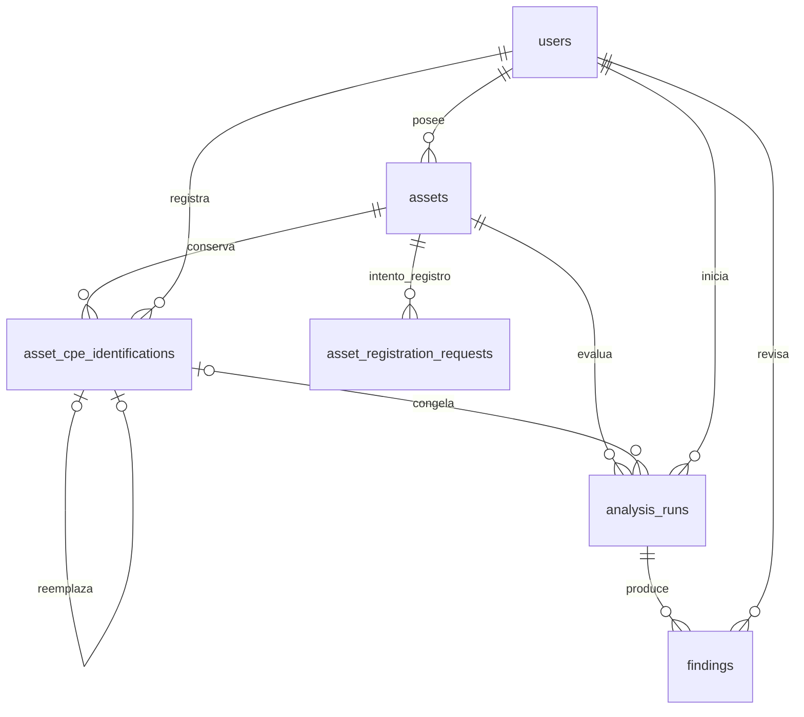

# Modelo de datos propuesto

**PROPUESTA PARA REVISIÓN — NO APROBADO.** Versión documental 0.1.0, 6 de noviembre de 2026. Ningún contrato nuevo se declara implementado. D-001 y D-002 conservan su estado APROBADA.

## Modelo conceptual propuesto, no migración

Una identificación solo puede ser reemplazada una vez; ramas concurrentes del historial se impiden bloqueando asset e índice único de replaces_id no nulo. `users`, `assets`, `analysis_runs`, `findings` y `asset_registration_requests` existen. **Una única tabla nueva** para selección e historial: `asset_cpe_identifications`. No catálogo completo CVE ni workspaces en MVP.

## Campos nuevos y adaptaciones

| Entidad | Campo / tipo / límite | Regla propuesta |
|---|---|---|
| assets | version text nullable | desconocida=null; CHECK permite null o texto válido 1–120; otras validaciones conservadas |
| assets | created_by uuid nullable para históricos | aplicar propuesta 0002 aprobada antes de nuevo diseño; registros nuevos por API siempre actor; no inventar dueños |
| asset_cpe_identifications | id UUID; asset_id UUID; recorded_by UUID; recorded_at timestamptz | PK y FK RESTRICT assets/users; UUID backend; fecha servidor UTC |
| misma | state text | solo confirmed/needs_review almacenados; pending es ausencia virtual |
| misma | cpe_name text 1–1024; cpe_name_id UUID | ambos requeridos en toda fila, copiados del previo para needs_review; parser backend + verificación NVD; formato SQL no certifica producto |
| misma | component_kind text; observed_version text nullable 1–120 | enum hardware/firmware/os/software; copia de versión del activo en momento del evento |
| misma | source text; validated_at timestamptz | source=NVD; confirmación fecha de verificación del candidato; needs_review conserva fecha de verificación anterior |
| misma | reason text 1–500 | obligatorio para confirmación y revisión, NFC sin controles ni secretos |
| misma | replaces_id UUID nullable; valid_to timestamptz nullable | FK compuesta (asset_id,replaces_id) a (asset_id,id); valid_to>=recorded_at; no reemplazarse a sí mismo |
| misma | idempotency_key UUID; request_hash char(64) | UNIQUE(asset_id,recorded_by,idempotency_key), huella hexadecimal; permanentes mientras dure histórico |
| analysis_runs | identification_id UUID nullable en legado | FK compuesta (asset_id,identification_id); nuevas ejecuciones exigen identificación confirmed actual al aceptar |
| misma | selected_cpe existente; observed_version text nullable | snapshot; id/CPE del evento en aceptación; no reinterpretar si evento cambia |
| misma | idempotency_key UUID nullable; request_hash char(64) nullable | par presente en nuevas ejecuciones; UNIQUE(asset_id,initiated_by,idempotency_key); actor de JWT |
| misma | total_results int nullable; retrieved_count int default 0; stored_count int default 0 | >=0; stored_count<=retrieved_count; total observado puede variar y no se fuerza retrieved<=total en SQL |
| misma | query_parameters jsonb; warning_codes jsonb; source_timestamps jsonb | objeto máximo 4 KiB, array de códigos máximo 20, array de fechas de hasta 5 páginas; shape validado backend y CHECK básico SQL |
| misma | failure_code text nullable 80 | código controlado, nunca mensaje externo o secreto |
| findings | applicability text | ampliar CHECK a potential/undetermined/not_applicable; not_applicable solo revisión; sin confirmed |
| misma | evidence jsonb | nullable para legado sin procedencia recuperable; obligatorio en nuevas ingestas, objeto máximo 64 KiB, contiene initial_applicability inmutable y datos pertinentes, nvd_last_modified, vulnStatus y referencias; no JSON NVD completo sin límite |
| misma | reviewed_by UUID nullable; reviewed_at timestamptz nullable | FK users RESTRICT; ambas presentes cuando status=reviewed para nuevos registros |
| misma | review_reason text nullable 1–500; review_evidence text nullable 1–2000 | obligatorias en revisión nueva; sin credenciales, sin URLs que backend consulte |
| asset_registration_requests | sin adaptación funcional | sigue solo registro `/assets`; no reutilizar para análisis ni eventos |

## Integridad e índices

Mantener PK/FK actuales RESTRICT; `asset_cpe_identifications` UNIQUE(asset_id,id) para FK compuesta e índice parcial único asset_id WHERE valid_to IS NULL, UNIQUE(replaces_id) donde no sea null, e índice (asset_id,recorded_at,id). Una fila nueva sin reemplazo solo es primera del activo. Invariantes de cierre/estado y ownership no se expresan solo con FK: validarlas en servicio transaccional, y restricciones/trigger de inmutabilidad a diseñar por Rudi en revisión; pruebas adversariales antes de declarar integridad. App solo puede cerrar valid_to de evento actual, no mutar snapshots o borrar historia. No otorgar DDL, DELETE, TRUNCATE ni UPDATE arbitrario.

Analysis: índice parcial único asset_id WHERE status IN (queued,running), para una consulta activa por activo; índice (asset_id,created_at,id) para listado; unicidad de claves de idempotencia con null para legado. Findings: UNIQUE(analysis_id,source,external_id), ya existe índice por analysis_id; comprobar duplicados históricos antes de añadir UNIQUE y no borrarlos silenciosamente. SQL debe mantener integridad básica, backend autoriza toda cadena activo→identificación→análisis→hallazgo; no basta initiated_by. Mínimos privilegios nuevos por columna y lectura autorizada de evidence/review, nunca del hash de contraseña en respuestas.

## Históricos y Alembic

0002 de Backend ya propone created_by, pero no se aplicó ni aprobó globalmente. Históricos sin dueño siguen invisibles a usuarios normales; no deducir propietario de initiated_by ni asignar al primer login. Eventos CPE no se crean por inferencia a partir de selected_cpe histórico: evidencia antigua puede mostrarse como legado con identification_id null. Nuevos flujos requieren los campos descritos; migración aditiva con validaciones para legado, restricciones progresivas y política explícita para antiguas revisiones. La matriz de snapshots V1/V1.1 debe ampliarse, no desactivar verificador ni usar stamp a ciegas. Diferenciar mínimo para selección (una tabla y version nullable) del mínimo para toda la vertical (además metadatos, revisión, unicidad e idempotencia indicados).

D-002: Rudi propone SQL/bootstrap/seed/grants; Jesel implementa ORM y revisión Alembic correspondiente, revisados por ambos. No editar baseline para fingir actualización de una base existente. Probar nueva instalación y evolución con datos, comparación de conteos, permisos, rollback transaccional y restauración aislada. No aplicar V2 004 en el camino MVP sin decisión de alcance; la compatibilidad de catálogo con 004 sigue NO VERIFICADA.
