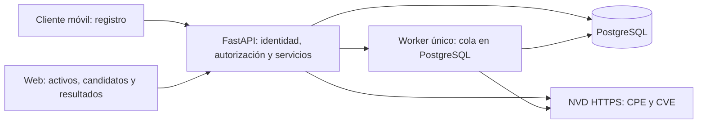
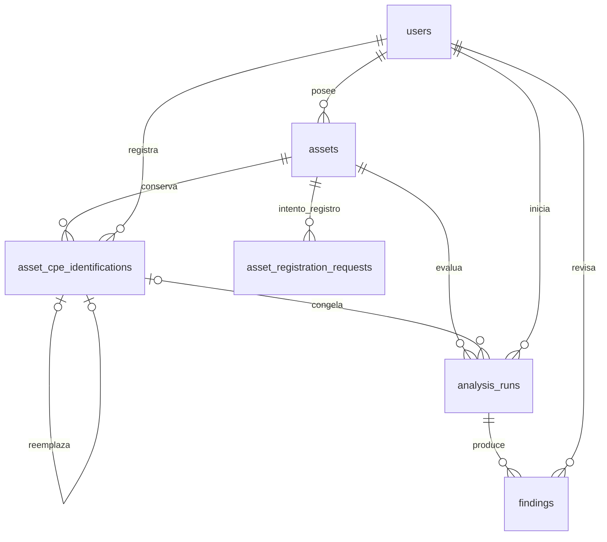

# VulnTrack — Contrato maestro propuesto del MVP

**PROPUESTA PARA REVISIÓN — NO APROBADO.** Versión documental 0.1.0, 6 de noviembre de 2026. Ningún contrato nuevo se declara implementado. D-001 y D-002 conservan su estado APROBADA.

Índice de secciones: 1. Identidad del proyecto, 2. Problema, 3. Objetivo general, 4. Objetivos específicos, 5. Usuarios, 6. Alcance, 7. Fuera de alcance, 8. Restricciones, 9. Recursos, 10. Stack, 11. Arquitectura general, 12. Registro de activos, 13. Campos del formulario, 14. Identificación CPE, 15. Consulta CVE, 16. Persistencia, 17. Modelo de datos, 18. Contrato API, 19. Reglas de negocio, 20. Seguridad, 21. Requisitos funcionales, 22. Requisitos no funcionales, 23. Criterios de aceptación, 24. Compatibilidad con el código actual, 25. Plan de implementación, 26. Riesgos, 27. Decisiones pendientes, 28. Glosario, 29. Fuentes, 30. Control de versiones y cambios.

## 1. Identidad del proyecto

VulnTrack, plataforma académica de inventario y seguimiento de vulnerabilidades **potenciales** de activos tecnológicos. Este documento es una especificación candidata completa, no sustituye el contexto aprobado ni convierte código implementado en una decisión aprobada.

## 2. Problema

Los datos administrativos de un equipo no bastan para identificar productos/versiones ni saber qué condiciones de vulnerabilidades conocidas podrían aplicar. Se necesita selección humana, persistencia y trazabilidad que comuniquen incertidumbre sin escanear dispositivos.

## 3. Objetivo general

Entregar una vertical verificable de registro manual → selección CPE → consulta CVE → evidencia → visualización y revisión, con autorización por activo y cobertura explícita.

## 4. Objetivos específicos

Registrar inventario aunque no se conozca versión/CPE; conservar formulario ante fallo; buscar candidatos oficiales sin inventarlos; confirmar identificación y mantener historial; consultar CVE con paginación limitada y trazabilidad; guardar resultados sin duplicación; presentar potencial/no determinado/revisión y permitir consulta histórica.

## 5. Usuarios

Personas usuarias autenticadas que registran y consultan sus propios activos en contexto académico; Jesel y Rudi mantienen el sistema, sin convertirlos automáticamente en administradores de datos. No se propone bypass de propiedad ni estructura colaborativa.

## 6. Alcance

PROPUESTA de primera fase: routers, switches y servidores, identificación principal de firmware/SO/software/hardware cuando sea verificable. Un CPE principal vigente por activo con historial. Cliente móvil mínimo online-first para registro y web para consulta, candidatos y resultados; dashboard básico usa listados y alcance visible. Los nombres actuales manufacturer/model siguen observación de inventario; query tecnológica editable permite identificar SO de un servidor de otro fabricante.

## 7. Fuera de alcance

Para esta fase propuesta: aplicaciones web como dominio propio, componentes múltiples, workspaces, RLS multitenant/HMAC, escáneres, ZAP, Nmap, confirmación de explotación, edición/eliminación general de activos, scheduler, sincronización offline completa, QR/GPS/cámara, CISA KEV, Redis, PDF de producto y secretos de clientes. El contexto previo sí incluye Baseline: CT-01 exige aprobación del aplazamiento y no se declara cumplido ese requisito.

## 8. Restricciones

D-001 contexto independiente y D-002 SQL/bootstrap en Database, ORM/Alembic en Backend. Dos personas y cuatro semanas de referencia; stack y varias políticas siguen propuestas formalmente aunque exista código. Esta misión solo produce documentos: ninguna implementación, migración, commit o aprobación. No descarga masiva NVD ni contactos a dispositivos.

## 9. Recursos

Repositorios locales bajo /home/mz/Desktop/VulnTrack; Backend V1.3 implementado, Database V1 materializada, V2 en origin/rudi como alternativa, contexto central e investigación/auditoría. Frontend local no tiene commits. Disponibilidad/dispositivo móvil/capacidad no confirmados; plan sujeto a puerta T01.

## 10. Stack

Reutilizar Python/FastAPI, Pydantic, SQLAlchemy/Psycopg, PostgreSQL y Alembic presentes; pytest y Ruff existentes para verificación posterior. React/Vite y React Native/Expo/TypeScript son propuestas centrales, no aplicaciones encontradas. Worker mínimo dentro de backend con persistencia SQL; no añadir broker. No se eligen nuevas librerías de CPE sin verificación de conformidad y mantenimiento.

## 11. Arquitectura general


Los clientes nunca conectan a SQL ni invocan NVD para el flujo del producto. No URLs arbitrarias. Es arquitectura PROPUESTA; no se ha implementado el worker.

## 12. Registro de activos

## Reglas normativas propuestas

Conservar cinco campos de inventario requeridos salvo `version`, que pasaría a nullable. String estricto, NFC y strip; rechazar vacío y caracteres de control/surrogates, extras desconocidos prohibidos. Para opcionales, omitido o null equivale a desconocido; no convertir `"unknown"`, `"*"` o `"-"` en versión real. Las longitudes son caracteres normalizados y se verifica además el límite de cuerpo HTTP actual de 8192 bytes. IP, GPS, puertos, credenciales y servicios expuestos no son campos de registro.

La versión se refiere al componente principal que el usuario desea identificar. En confirmación mostrar explícitamente componente y versión observada; si la versión de inventario no describe el producto elegido, rechazar la confirmación como identificación suficientemente específica y explicar que se necesita corrección de inventario. La edición general de activos sigue POSTERIOR; para una demo actual se puede registrar otro activo correcto, sin borrar ni reasignar el anterior. No prometer completar la versión después sin aprobar e implementar edición. Puede confirmarse una selección incompleta con version null, pero no solicitar evaluación CVE específica: 409 VERSION_REQUIRED.

`product_query` es ayuda de búsqueda, no dato persistente nuevo del activo; no añadir dos versiones de SO/firmware al formulario del MVP. Un servidor físico puede tener SO como componente principal: fabricante/modelo del inventario siguen siendo observados del equipo y la búsqueda tecnológica puede usar fabricante/producto del SO; la pantalla debe evitar confundir ambos. Para producto principal distinto del hardware, la consulta `query` es editable y no se compone siempre a partir del fabricante físico.

## Boceto e interacción

```text
Activo: [router | switch | servidor]
Fabricante [Cisco]  Modelo [RV340]
Versión del componente principal [1.0.0.33] [ ] No la conozco
Ubicación [LAB-A]  Etiqueta opcional [ ]
Notas no sensibles [ ]                       [Guardar activo]
Identificación tecnológica (después de guardar)
Buscar producto [Cisco RV340 firmware]        [Buscar candidatos]
Componente [firmware] Versión observada [solo lectura]
Candidatos: fabricante/producto/versión/update/plataforma/deprecado
[Confirmar candidato]  [Mantener pendiente]
```

Ejemplo JSON PROPUESTO tras adaptación: `{"device_type":"router","manufacturer":"Cisco","model":"RV340","version":null,"site_label":"LAB-A","inventory_label":null,"notes":null}`. Ese null **hoy devuelve validación fallida**. Errores orientados al usuario: «Indica fabricante/modelo/sitio»; «Versión desconocida: puedes registrar, pero no evaluar de forma específica»; «La versión o componente no concuerda: revisa tu elección»; «No hay candidatos para esta búsqueda; el activo sigue guardado». La selección nunca es automática y la pérdida de red conserva formulario y clave del mismo intento.


## 13. Campos del formulario

| Nombre funcional / técnico | Tipo y límite propuesto | Registro / identificación | Ejemplo y desconocido | CPE, PostgreSQL y V1.3 |
|---|---|---|---|---|
| Tipo / `device_type` | string estricto 1–80 | obligatorio registrar | `router`; desconocido exige elegir router/switch/server en UI, sin inventar categoría | inventario, no part; columna actual; conservar texto libre en API para históricos, UI MVP limitada |
| Fabricante / `manufacturer` | string 1–120 | obligatorio registrar, término de búsqueda | `Cisco`; desconocido impide registro conforme contrato actual | no equivale automáticamente a vendor; columna y API actuales |
| Modelo / `model` | string 1–120 | obligatorio registrar, orienta búsqueda | `RV340`; no sustituir desconocido por texto ficticio | modelo comercial puede diferir de product; columna/API actuales |
| Versión principal observada / `version` | string 1–120 o null | opcional registrar; requerida para solicitar evaluación específica en este MVP | `1.0.0.33` o null; conservar sufijos | NOT NULL y string hoy: requiere SQL/ORM/Pydantic y compatibilidad de clientes |
| Ubicación administrativa / `site_label` | string 1–120 | obligatorio registrar | `LAB-A`; nunca enviar a NVD | columna/API actuales, no es target_sw ni sitio web |
| Inventario / `inventory_label` | string 1–120 o null | opcional | `INV-01`; omitir/null, no vacío | columna/API actuales; no imponer unicidad nueva |
| Notas / `notes` | string 1–1000 o null | opcional | `Equipo de laboratorio`; sin secretos | columna/API actuales; no analizar como query NVD |
| Nombre administrativo / `display_name` | no persistir en MVP | opcional, derivado de manufacturer + model | presentación `Cisco RV340` | no añadir columna ni aceptar propiedad JSON nueva |
| Producto o SO observado / `product_query` | string 1–160 | opcional en búsqueda; reemplaza consulta ambigua, no fabricante del inventario | `Small Business RV340 Firmware`; vacío se omite | no es campo de AssetCreate; solo query efímera; candidato confirma producto real |
| Componente principal / `component_kind` | enum `hardware`, `firmware`, `os`, `software` | obligatorio al confirmar | `firmware`; sin elección no confirmar | nuevo campo de identificación; no deducir part exclusivamente de categoría de activo |
| Versión observada de la identificación / `observed_version` | string 1–120 o null, copiada de assets.version al crear evento | backend; solo lectura | `1.0.0.33` o null | snapshot; versión del CPE se conserva separada, no altera inventario |
| Nombre CPE / `cpe_name` | string parseable CPE 2.3, máximo 1024 | derivado NVD; nunca obligatorio registrar | nombre real retornado por catálogo | nuevo en identificación, snapshot ya existe en analysis_runs.selected_cpe |
| ID de diccionario / `cpe_name_id` | UUID | obligatorio confirmar estado confirmed, derivado NVD | `C817E5BA-62C1-41E7-A15C-FB851FEA761E` | no confundir con matchCriteriaId; columna nueva |
| Estado / `state` | `pending`, `confirmed`, `needs_review` | backend según operación explícita | sin fila: pending; cero candidatos es resultado efímero | nuevo recurso, no renombrar status del análisis |
| Actor y fecha / `recorded_by`, `recorded_at` | UUID autenticado, timestamptz UTC | generados backend | nunca aceptados del cliente | FK users; nuevo historial; confirmación es recorded_by/at cuando state=confirmed |
| Fuente y validación / `source`, `validated_at` | `NVD`, timestamptz UTC | backend al confirmar | sin conexión válida no confirmar selección nueva | nuevo snapshot de procedencia |
| Propietario / `created_by` | UUID, nullable solo para legado | generado backend | actor de JWT, nunca body | presente en ORM y 0002; ausente en baseline Database V1 |


## 14. Identificación CPE

## Contrato y nomenclatura

`cpe_name` es el nombre CPE 2.3 devuelto por el diccionario; `cpe_name_id` su UUID. `matchCriteriaId` identifica un criterio publicado en configuración CVE y no identifica la selección local. La versión observada no se reescribe con la versión normalizada de NVD. Un `part=h` identifica hardware, `o` SO/firmware, `a` aplicación; ni el tipo router ni el nombre comercial bastan para elegirlo.

La búsqueda usa GET `/api/v1/cpe-candidates` con `query` (2–200 caracteres), `limit` (1–20, default 10), `offset` (0–10000) y opcional `product_query` (1–160). Para evitar dos términos de búsqueda superpuestos, cuando hay product_query el backend construye keywordSearch con query más product_query; la UI puede omitir product_query y enviar directamente una query tecnológica completa. Normalizar NFC/strip, sin controles, no transliterar ni inventar vendor/product; URL encoding al enviar `keywordSearch`, `resultsPerPage`, `startIndex`. No concatenar un CPE definitivo. No enviar sitio, inventario o notas. La búsqueda requiere autenticación, pero los candidatos son catálogo público; no hay recursos ajenos que consultar.

Cada candidato muestra `cpe_name`, `cpe_name_id`, título, deprecated y metadatos de consulta. Comparar part, vendor, product, version, update y plataforma; destacar discrepancias. Búsqueda vacía responde 200 items vacíos; fallos NVD son errores, no «sin coincidencia». El UUID se resuelve nuevamente mediante `cpeNameId` antes de confirmar; ambas cadenas deben corresponder al registro oficial y no estar deprecadas. Prohibir reemplazar un registro deprecado sin elección humana; sugerir nueva búsqueda. Si NVD no está disponible no se escribe confirmación.

## Estados y transiciones

| Estado anterior | Operación | Resultado permitido | Condición |
|---|---|---|---|
| sin identificación (`pending` virtual) | confirmar | confirmed | propietario activo, candidato válido, component_kind, versión mostrada, motivo, expected_current_id=null |
| pending / confirmed / needs_review | confirmar | confirmed (nuevo evento) | expected_current_id coincide; motivo, NVD revalidado y verificación explícita de usuario |
| confirmed | marcar revisión | needs_review (nuevo evento) | motivo obligatorio; copia referencia al candidato anterior, sin tratarlo como confirmación vigente |
| needs_review | marcar revisión | prohibido 409 INVALID_TRANSITION | evitar eventos redundantes |
| pending | marcar revisión | prohibido 409 INVALID_TRANSITION | no existe confirmación que revisar |
| cualquiera | borrar historial o reabrir fila antigua | prohibido | historial inmutable, no DELETE API |

`SIN_COINCIDENCIA` y «candidatos encontrados» son resultados de búsqueda fechados en UI, no estados persistidos de identificación: evitan confundir ausencia momentánea de catálogo con identidad del activo. No se crea fila pending; se representa cuando no hay evento actual. Una selección confirmed puede tener observed_version null: identidad revisada, evaluación específica bloqueada por versión insuficiente. No crea certeza de aplicabilidad.

## Historial y concurrencia

Tabla única `asset_cpe_identifications`: cada cambio crea una fila, cierra `valid_to` del evento actual y lo referencia con `replaces_id`. Una fila representa tanto identificación como historial; no añadir tabla de historial duplicada. Confirmaciones conservan UUID/nombre, component_kind, observed_version, actor/fecha, motivo, fuente y validated_at. Un evento needs_review copia esos datos del evento anterior pero su recorded_by/at corresponde al revisor, no a la confirmación anterior; ésta sigue en la fila referenciada. La UI no muestra recorded_at de un evento needs_review como nueva fecha de confirmación.

Bloquear fila assets en transacción corta; comprobar propietario y `expected_current_id`, cerrar actual e insertar evento de forma atómica. Un índice único parcial por asset_id con valid_to null impide dos actuales. Primer registro exige expected_current_id=null; dos confirmaciones distintas simultáneas: una gana y otra recibe 409 CURRENT_IDENTIFICATION_CHANGED. Idempotencia por actor/activo/clave: comprobar replay autorizado antes de expected_current_id; hash incluye cuerpo normalizado y ruta. Misma clave/cuerpo devuelve evento original; distinta huella 409 IDEMPOTENCY_CONFLICT. La respuesta de creación solo contiene campos inmutables para replay estable; consultas GET añaden valid_to e is_current calculado. No usar la tabla V1 cuya ruta está fijada a `/assets`.

Datos históricos permanecen ligados a sus análisis. Si cambia identificación, el dashboard marca análisis anterior como «de identificación previa», no reinterpreta hallazgos ni elimina evidencia. Un error humano se corrige con un evento nuevo y motivo.


## 15. Consulta CVE

## Precondiciones y flujo

Autenticar usuario activo, autorizar activo y verificar que `identification_id` pertenece al activo, es el evento actual y tiene state=confirmed. La versión observada debe ser conocida para esta consulta específica: 409 VERSION_REQUIRED ante null. El usuario confirma el alcance principal; no equiparar versión comercial con CPE. Si part/version del CPE no permiten filtro específico, responder 409 IDENTIFICATION_INCOMPLETE; no sustituir por una búsqueda vaga. CPE hardware con versión NA exige revisión explícita de revisión/plataforma y nunca acredita firmware; el primer MVP puede bloquearlo como no suficientemente específico hasta verificar esa ruta de API. Preferir firmware o SO identificable.

Crear ejecución queued con copia inmutable del CPE y versión observada, parámetros y FK a identificación. La selección se comprueba bajo bloqueo de assets al aceptar, y queda congelada aunque después cambie. Responder 202 tras persistir aceptación. Un worker del mismo backend toma tareas queued bajo bloqueo; no Redis ni nuevo broker. La reanudación tras caída no reacepta la misma clave; tareas running sin finalización se cierran al recuperar el proceso: completed/partial con aviso INTERRUPTED si existen páginas válidas persistidas y estado consistente, failed con coverage null si no existen; una tarea ya finalizada no se modifica y el usuario puede solicitar nueva ejecución con otra clave. La política operativa debe probarse antes de habilitar 202; no usar memoria como única cola.

NVD solo desde backend: HTTPS y host fijo, `/rest/json/cves/2.0` con cpeName codificado y paginación `startIndex/resultsPerPage`. Parámetros de rangos/virtualMatchString no se usan en MVP hasta verificación oficial adicional. No esperar red con transacción SQL abierta. Política de presupuesto propuesta (no cuota oficial): un request cada 7 s, cola global única, máximo 5 páginas de 100 elementos y 5 minutos por ejecución, timeout externo 15 s, hasta 2 reintentos con retroceso para transitorios; límite efectivo siempre menor o igual a cuota oficial vigente, a verificar antes de ejecutar cliente productivo. 403/429 detienen solicitudes nuevas de la ejecución y respetan Retry-After si existe; no eludir restricciones. Cache acotada para catálogo, no réplica NVD; consulta manual de actualización crea ejecución nueva.

## Cobertura independiente de aplicabilidad

| Persistencia | API/dashboard | Condición |
|---|---|---|
| queued, coverage=null | pendiente | aceptada sin respuesta externa |
| running, coverage=null | en curso | trabajo iniciado, sin promesa de totalidad |
| completed, coverage=complete | consulta completa | todas las páginas verificadas de parámetros fijados, sin truncamiento ni cambios de total detectados |
| completed, coverage=partial | consulta parcial | al menos una página válida, pero límite/fallo posterior o incertidumbre de paginación |
| failed, coverage=null | fallida | no hay página válida completa o error de procesamiento impide publicar resultados |

Una página válida con total=0 puede completar la consulta sin hallazgos; no significa activo seguro. Un resultado JSON malformado no se convierte en total cero. `retrieved_count` cuenta entradas procesadas; `stored_count` cuenta CVE distintos persistidos; `total_results` es total observado NVD (nullable antes de respuesta); conservar progress y warning_codes. Si cambian totalResults u orden entre páginas, no asegurar snapshot de NVD: partial con aviso. `complete` se refiere a consulta, no a cobertura universal de vulnerabilidades.

**Evidencia histórica, no reejecutada:** RV340 firmware 1.0.0.33, 1/1; TL-SG108E firmware 1.1.2, 2/5; Ubuntu Linux 10.04 LTS, 2/521. Las dos últimas fueron muestras parciales. En TL-SG108E el CVE incluía AND firmware/hardware; vulnerable=false en nodo hardware no descarta el CVE, puede expresar entorno necesario.

## Semántica de resultado y seguimiento

- CVE recuperado: dato devuelto por consulta, todavía no conclusión del sistema.
- `potential`: hay criterio relevante al producto/versión, sin incompatibilidad demostrada; no confirma vulnerabilidad ni explotación.
- `undetermined`: condiciones/versión/configuración faltantes o evaluador no soportado; UI «requiere revisión».
- `not_applicable`: solo revisión humana con evidencia suficiente y motivo; conservar hallazgo y dato original.
- `confirmed` no forma parte del vocabulario de aplicabilidad del MVP. Una metodología externa podría estudiarse después, sin asignarla por NVD.

Separar `findings.status` (open/reviewed) de `findings.applicability`. AND requiere todas las condiciones; OR admite alternativas; negación y rangos deben preservarse. El MVP no implementará un evaluador universal: ante configuración compleja no verificada, marcar undetermined y presentar evidencia, nunca simplificar con contains ni comparar versiones por orden lexicográfico. Rangos inclusivos/exclusivos y UUID de criterio se guardan tal como se reciben; no asumir semver en todos los fabricantes.

## Persistencia y actualización

Reutilizar analysis_runs y findings. Una ejecución hace upsert controlado por `(analysis_id,source,external_id)`; JSON de evidencia acotado incluye configuraciones pertinentes, identificadores de criterio, timestamps, estado NVD y referencias HTTPS no ejecutables. Límite de 64 KiB por evidencia; si requiere truncamiento, conservar aviso y marcar undetermined. No introducir campos de procedencia dentro de cvss: guardar CVSS original en su columna y metadatos en evidence. Transacciones por página válida; cobertura solo se completa al terminar. No publicar complete ante rollback de última página.

La revisión necesita expected_updated_at para controlar concurrencia y motivo/evidencia acotada; en MVP solo transición open→reviewed. El resultado de ingesta original se conserva en evidence.initial_applicability, revisión se guarda en review_by/reviewed_at/review_reason/review_evidence; no habilitar revisiones repetidas sin un historial de revisiones aprobado. Nueva evaluación siempre genera otro análisis. No borrar histórico ni reescribir el efecto de una selección anterior. Retención: conservar registros de ejecución/revisión durante el proyecto, limpieza únicamente con política posterior aprobada. Los resultados de origen no se presentan como españoles originales: textos externos pueden estar en otro idioma, la interfaz sí comunica estados en español.


## 16. Persistencia

Reutilizar tablas de ejecución/hallazgo, conservar snapshots y fuentes y diferenciar complete/partial de aplicabilidad. Eventos de identificación conservan historia en una sola tabla. Las claves nuevas viven en filas de evento/ejecución; la tabla técnica V1 de registro sigue intacta. El esquema detallado de la sección17 es normativo como propuesta; no basta un campo CPE suelto en assets.

## 17. Modelo de datos

## Modelo conceptual propuesto, no migración



Una identificación solo puede ser reemplazada una vez; ramas concurrentes del historial se impiden bloqueando asset e índice único de replaces_id no nulo. `users`, `assets`, `analysis_runs`, `findings` y `asset_registration_requests` existen. **Una única tabla nueva** para selección e historial: `asset_cpe_identifications`. No catálogo completo CVE ni workspaces en MVP.

## Campos nuevos y adaptaciones

| Entidad | Campo / tipo / límite | Regla propuesta |
|---|---|---|
| assets | version text nullable | desconocida=null; CHECK permite null o texto válido 1–120; otras validaciones conservadas |
| assets | created_by uuid nullable para históricos | aplicar propuesta 0002 aprobada antes de nuevo diseño; registros nuevos por API siempre actor; no inventar dueños |
| asset_cpe_identifications | id UUID; asset_id UUID; recorded_by UUID; recorded_at timestamptz | PK y FK RESTRICT assets/users; UUID backend; fecha servidor UTC |
| misma | state text | solo confirmed/needs_review almacenados; pending es ausencia virtual |
| misma | cpe_name text 1–1024; cpe_name_id UUID | ambos requeridos en toda fila, copiados del previo para needs_review; parser backend + verificación NVD; formato SQL no certifica producto |
| misma | component_kind text; observed_version text nullable 1–120 | enum hardware/firmware/os/software; copia de versión del activo en momento del evento |
| misma | source text; validated_at timestamptz | source=NVD; confirmación fecha de verificación del candidato; needs_review conserva fecha de verificación anterior |
| misma | reason text 1–500 | obligatorio para confirmación y revisión, NFC sin controles ni secretos |
| misma | replaces_id UUID nullable; valid_to timestamptz nullable | FK compuesta (asset_id,replaces_id) a (asset_id,id); valid_to>=recorded_at; no reemplazarse a sí mismo |
| misma | idempotency_key UUID; request_hash char(64) | UNIQUE(asset_id,recorded_by,idempotency_key), huella hexadecimal; permanentes mientras dure histórico |
| analysis_runs | identification_id UUID nullable en legado | FK compuesta (asset_id,identification_id); nuevas ejecuciones exigen identificación confirmed actual al aceptar |
| misma | selected_cpe existente; observed_version text nullable | snapshot; id/CPE del evento en aceptación; no reinterpretar si evento cambia |
| misma | idempotency_key UUID nullable; request_hash char(64) nullable | par presente en nuevas ejecuciones; UNIQUE(asset_id,initiated_by,idempotency_key); actor de JWT |
| misma | total_results int nullable; retrieved_count int default 0; stored_count int default 0 | >=0; stored_count<=retrieved_count; total observado puede variar y no se fuerza retrieved<=total en SQL |
| misma | query_parameters jsonb; warning_codes jsonb; source_timestamps jsonb | objeto máximo 4 KiB, array de códigos máximo 20, array de fechas de hasta 5 páginas; shape validado backend y CHECK básico SQL |
| misma | failure_code text nullable 80 | código controlado, nunca mensaje externo o secreto |
| findings | applicability text | ampliar CHECK a potential/undetermined/not_applicable; not_applicable solo revisión; sin confirmed |
| misma | evidence jsonb | nullable para legado sin procedencia recuperable; obligatorio en nuevas ingestas, objeto máximo 64 KiB, contiene initial_applicability inmutable y datos pertinentes, nvd_last_modified, vulnStatus y referencias; no JSON NVD completo sin límite |
| misma | reviewed_by UUID nullable; reviewed_at timestamptz nullable | FK users RESTRICT; ambas presentes cuando status=reviewed para nuevos registros |
| misma | review_reason text nullable 1–500; review_evidence text nullable 1–2000 | obligatorias en revisión nueva; sin credenciales, sin URLs que backend consulte |
| asset_registration_requests | sin adaptación funcional | sigue solo registro `/assets`; no reutilizar para análisis ni eventos |

## Integridad e índices

Mantener PK/FK actuales RESTRICT; `asset_cpe_identifications` UNIQUE(asset_id,id) para FK compuesta e índice parcial único asset_id WHERE valid_to IS NULL, UNIQUE(replaces_id) donde no sea null, e índice (asset_id,recorded_at,id). Una fila nueva sin reemplazo solo es primera del activo. Invariantes de cierre/estado y ownership no se expresan solo con FK: validarlas en servicio transaccional, y restricciones/trigger de inmutabilidad a diseñar por Rudi en revisión; pruebas adversariales antes de declarar integridad. App solo puede cerrar valid_to de evento actual, no mutar snapshots o borrar historia. No otorgar DDL, DELETE, TRUNCATE ni UPDATE arbitrario.

Analysis: índice parcial único asset_id WHERE status IN (queued,running), para una consulta activa por activo; índice (asset_id,created_at,id) para listado; unicidad de claves de idempotencia con null para legado. Findings: UNIQUE(analysis_id,source,external_id), ya existe índice por analysis_id; comprobar duplicados históricos antes de añadir UNIQUE y no borrarlos silenciosamente. SQL debe mantener integridad básica, backend autoriza toda cadena activo→identificación→análisis→hallazgo; no basta initiated_by. Mínimos privilegios nuevos por columna y lectura autorizada de evidence/review, nunca del hash de contraseña en respuestas.

## Históricos y Alembic

0002 de Backend ya propone created_by, pero no se aplicó ni aprobó globalmente. Históricos sin dueño siguen invisibles a usuarios normales; no deducir propietario de initiated_by ni asignar al primer login. Eventos CPE no se crean por inferencia a partir de selected_cpe histórico: evidencia antigua puede mostrarse como legado con identification_id null. Nuevos flujos requieren los campos descritos; migración aditiva con validaciones para legado, restricciones progresivas y política explícita para antiguas revisiones. La matriz de snapshots V1/V1.1 debe ampliarse, no desactivar verificador ni usar stamp a ciegas. Diferenciar mínimo para selección (una tabla y version nullable) del mínimo para toda la vertical (además metadatos, revisión, unicidad e idempotencia indicados).

D-002: Rudi propone SQL/bootstrap/seed/grants; Jesel implementa ORM y revisión Alembic correspondiente, revisados por ambos. No editar baseline para fingir actualización de una base existente. Probar nueva instalación y evolución con datos, comparación de conteos, permisos, rollback transaccional y restauración aislada. No aplicar V2 004 en el camino MVP sin decisión de alcance; la compatibilidad de catálogo con 004 sigue NO VERIFICADA.


## 18. Contrato API

## Convenciones y rutas canónicas

Todas las rutas externas usan `/api/v1`; los endpoints de salud existentes son GET `/health` y GET `/ready`. Login no requiere token; el resto requiere JWT válido y usuario activo. Nuevas operaciones de datos exigen propietario del activo; identidad desde JWT, nunca supplied owner. 404 para recurso ajeno/inexistente/sin propietario, antes de acceder a NVD. Variables de ruta UUID. Extras JSON prohibidos; fechas UTC ISO8601; longitudes y normalización del formulario. Error común conserva `{error:{code,message,request_id}}`; 401 con WWW-Authenticate Bearer, 429 con Retry-After; no transmitir errores externos en bruto.

| Estado | Método | Ruta canónica | Contrato mínimo |
|---|---|---|---|
| EXISTENTE | POST | /api/v1/auth/login | Login: username ASCII 1–80 y password 1–256; Token access_token/token_type/expires_in; 200,401,422,429; no Bearer |
| EXISTENTE | GET | /api/v1/auth/me | Bearer; UserRead id/username; 200,401 |
| CAMBIO PROPUESTO | POST | /api/v1/assets | Bearer; AssetCreate con version nullable tras migración; Idempotency-Key UUID; 201 AssetRead y Location; 401,409,413,422 |
| CAMBIO PROPUESTO | GET | /api/v1/assets | Bearer; limit 1–100 default20, offset 0–1000000; items/page; admitir version null en lectura |
| CAMBIO PROPUESTO | GET | /api/v1/assets/{asset_id} | Bearer y propietario; AssetRead; 200,401,404,422; admitir version null |
| NUEVO PROPUESTO | GET | /api/v1/cpe-candidates | Bearer; query, product_query opcional, limit 1–20 default10, offset 0–10000; 200 items/page/source_timestamp; 401,422,429,502,503,504 |
| NUEVO PROPUESTO | POST | /api/v1/assets/{asset_id}/cpe-identifications | Bearer y propietario; body discriminado, Idempotency-Key; 201 evento inmutable, Location; 401,404,409,413,422,429,502,503,504 |
| NUEVO PROPUESTO | GET | /api/v1/assets/{asset_id}/cpe-identifications | Bearer y propietario; scope=current|history defaultcurrent, limit 1–100 default20, offset 0–1000000; 200 current_state/items/page; 401,404,422 |
| NUEVO PROPUESTO | POST | /api/v1/assets/{asset_id}/analyses | Bearer y propietario; identification_id UUID, Idempotency-Key UUID; 202 id/accepted_at y Location; 401,404,409,413,422,429,503 |
| NUEVO PROPUESTO | GET | /api/v1/assets/{asset_id}/analyses | Bearer y propietario; limit/offset como listado actual; 200 items/page; 401,404,422 |
| NUEVO PROPUESTO | GET | /api/v1/assets/{asset_id}/analyses/{run_id} | Bearer y propietario, run pertenece a asset; 200 estado/coverage/conteos/avisos; 401,404,422 |
| NUEVO PROPUESTO | GET | /api/v1/assets/{asset_id}/analyses/{run_id}/findings | Bearer y propietario de toda la cadena; limit/offset; 200 items/page/run_status/coverage; 401,404,422 |
| NUEVO PROPUESTO | PATCH | /api/v1/assets/{asset_id}/analyses/{run_id}/findings/{finding_id} | Bearer y propietario de toda la cadena; revisión única y expected_updated_at; 200 hallazgo; 401,404,409,413,422 |

No diseñar aliases `/cpe/search`, `/cve-check`, `cpe-selection` o `selection_id` en el nuevo contrato: son propuestas antecedentes, no rutas implementadas. Campo local único: `identification_id`. Esta convergencia requiere DEC-10/DEC-01, no altera documentos previos. PATCH/DELETE de activos, refresh/logout, dashboard-summary especializado, workspaces y escaneos son POSTERIOR; dashboard mínimo utiliza listados existentes y nuevos sin sumar ejecuciones como si fueran CVE únicos.

## JSON propuesto por operación nueva

Ejemplos ilustrativos salvo nombre/UUID NVD proveniente de consulta histórica. UUID de activos/eventos/ejecuciones y fechas locales de ejemplos son ficticios. No se ejecutó ningún endpoint nuevo.

**Candidatos:** GET con `query=Cisco RV340 firmware`. Respuesta abreviada de estructura propuesta:
```json
{"items":[{"cpe_name_id":"C817E5BA-62C1-41E7-A15C-FB851FEA761E","cpe_name":"cpe:2.3:o:cisco:small_business_rv340_firmware:1.0.0.33:*:*:*:*:*:*:*","title":"Cisco Small Business RV340 Firmware 1.0.0.33","deprecated":false}],"page":{"limit":10,"offset":0,"total":1},"source_timestamp":"2026-11-06T06:30:00Z"}
```
El total 1 de este JSON es simulado para explicar estructura, no el resultado histórico de esa búsqueda. source_timestamp identifica la respuesta de origen, no confirmación del activo.

**Confirmación:** POST al recurso cpe-identifications, cuerpo:
```json
{"state":"confirmed","cpe_name_id":"C817E5BA-62C1-41E7-A15C-FB851FEA761E","component_kind":"firmware","expected_current_id":null,"reason":"Comparado con los datos observados del equipo"}
```
respuesta 201 estable (forma abreviada):
```json
{"id":"11111111-1111-4111-8111-111111111111","state":"confirmed","cpe_name_id":"C817E5BA-62C1-41E7-A15C-FB851FEA761E","cpe_name":"cpe:2.3:o:cisco:small_business_rv340_firmware:1.0.0.33:*:*:*:*:*:*:*","recorded_at":"2026-11-06T06:30:00Z"}
```
Respuesta completa añade asset_id, component_kind, observed_version, source, validated_at, recorded_by, reason y replaces_id (igual a expected_current_id aceptado); no incluye valid_to ni is_current, que pueden cambiar. Marcar revisión usa el mismo POST: `{ "state":"needs_review", "expected_current_id":"11111111-1111-4111-8111-111111111111", "reason":"El candidato ya no coincide" }`; otros campos se copian del anterior. confirmed exige cpe_name_id y component_kind; needs_review prohíbe ambos como input. expected_current_id y reason son siempre requeridos.

**Lectura actual/historia:** GET scope=current devuelve `{current_state:"pending",items:[],page:{limit:20,offset:0,total:0}}` sin identificación. Si existe, items contiene la fila actual con valid_to=null e is_current=true. scope=history ordena recorded_at/id ascendente e incluye todas las filas, con valid_to e is_current calculados; current_state informa el evento actual. No mezclar significado de total entre scope actual e histórico.

**Solicitar CVE:** POST analyses `{ "identification_id":"11111111-1111-4111-8111-111111111111" }`. Respuesta 202 `{ "id":"22222222-2222-4222-8222-222222222222", "accepted_at":"2026-11-06T06:31:00Z" }`, Location del GET de ejecución. accepted_at es created_at; el replay no miente sobre estado actual porque no incluye status mutable. GET listado devuelve `{items:[<resumen de ejecución>],page:{limit,offset,total}}`; GET detalle incluye identificación/CPE congelados y:
```json
{"id":"22222222-2222-4222-8222-222222222222","status":"completed","coverage":"partial","total_results":5,"retrieved_count":2,"stored_count":2,"warning_codes":["PAGE_BUDGET_REACHED"]}
```
Forma abreviada: detalle completo añade asset_id, identification_id, selected_cpe, observed_version, initiated_by, created_at, started_at, completed_at, source_timestamp y failure_code. Estas fechas/estados son ejemplo simulado, no ejecución histórica almacenada.

**Hallazgos:** GET devuelve `{items:[{id,external_id,source,title,applicability,status,cvss,evidence,updated_at}],page:{limit,offset,total},run_status,coverage}`. JSON simbólico de estructura, no JSON ejecutable con valores NVD inventados. evidence solo expone datos públicos necesarios. No derivar un conteo global de vulnerabilidades sumando CVE repetidos de varios análisis. Mostrar por defecto resultados de la última ejecución seleccionada con su alcance, incluso si hubo consulta parcial.

**Revisión:** PATCH cuerpo ilustrativo:
```json
{"status":"reviewed","applicability":"not_applicable","expected_updated_at":"2026-11-06T06:32:00Z","reason":"La plataforma requerida no está presente","evidence":"Revisión documental del componente principal"}
```
Respuesta 200 devuelve hallazgo con reviewed_by, reviewed_at, review_reason y review_evidence. No existe valor confirmed. potential/undetermined/not_applicable permitidos con motivo y evidencia; exactamente una revisión en MVP. Fecha esperada distinta o ya reviewed: 409 REVIEW_CONFLICT; tras respuesta perdida, cliente reconcilia con GET, no reintenta ciegamente PATCH.

## Idempotencia y límites propuestos

Registro mantiene política actual 24 h y hash v1; al introducir version null conservar hash de solicitudes antiguas y probar replay de snapshots previos, sin recálculo masivo. Confirmación y análisis guardan clave y huella en su fila, no usan asset_registration_requests; claves conservadas durante retención del proyecto, mismo actor/activo/operación. Autorización siempre antes de replay; misma clave distinto hash 409; replay devuelve mismo código y recurso. Mutex transaccional y UNIQUE resuelven carreras. Post de análisis bloquea segunda consulta activa del activo con 409 ANALYSIS_IN_PROGRESS; misma clave se resuelve primero como replay.

Límites propuestos: candidatos 6 solicitudes/minuto/usuario, confirmaciones 6/minuto/usuario, nuevas ejecuciones 1/minuto/activo y una activa por activo. Nunca confundirlos con cuota NVD oficial. Limitar presupuesto global y verificación de cuota antes de habilitar integración; 429 no es fallo definitivo. CORS actual permite GET/POST; PATCH nuevo requiere adaptar allow-methods y preflight más tests; headers de idempotencia actuales ya contemplados. Todos los nuevos métodos conservan cuerpo máximo 8192, no-store y request_id; no se añade If-Match para evitar cambio de headers, se usa expected_updated_at.


## 19. Reglas de negocio

BR-01: propietario sale del usuario autenticado; no body de propietario. BR-02: registro sin CPE permitido; null versión solo tras adaptación. BR-03: no selección automática, confirmado requiere resolución oficial y aceptación humana. BR-04: un evento actual por activo y cambios append-only con cierre atómico. BR-05: consulta específica solo identificación actual confirmed y versión conocida/suficiente; análisis congela selección al aceptar. BR-06: mismo intento conserva clave/cuerpo, otra intención nueva clave; autorización precede replay. BR-07: no convertir error externo o páginas ausentes en cero CVE. BR-08: no valor confirmed en hallazgo ni inferencia de explotación. BR-09: revisión única con evidencia y control de concurrencia; historia de selecciones nunca se borra. BR-10: datos de origen y resultado humano se conservan separadamente. BR-11: cambio de identificación no reescribe análisis antiguos; dashboard indica vigencia. BR-12: no se amplía alcance ni se atribuyen aprobaciones por este documento.

## 20. Seguridad

Autenticación JWT/usuario activo reutilizada. Autorización por assets.created_by en cada lectura, confirmación, replay, análisis y revisión, incluyendo pertenencia de cada UUID a sus padres; 404 para ajeno. Un token válido no autoriza por sí mismo el recurso. Históricos sin dueño no se reasignan. No se habilita RLS V1 ni HMAC/workspaces sin diseño aprobado. SQL parametrizado, rol runtime no propietario y grants por columna; nunca credenciales administrativas para API.

Solo backend invoca NVD con host/rutas HTTPS fijados, query codificada, redirecciones deshabilitadas y sin fetching de referencias CVE. No URLs arbitrarias, IPs de dispositivos ni secretos en formulario, logs o payloads. Parser CPE y verificación de UUID en diccionario; validación sintáctica no demuestra producto presente. Cuotas globales y por usuario, timeout, máximo de bytes de respuesta propuesto 2 MiB y evidencia 64KiB, reintentos limitados, 403/429 no eludidos. Códigos seguros de error con request_id, no cuerpos o tokens de origen. Cache pública acotada de catálogo, datos privados nunca mezclados por usuario. Estados y evidencia de NVD se tratan como datos externos, no HTML ejecutable.

Transacciones cortas, mutex por activo, claves con huella y UNIQUE. No mantener locks durante consulta externa; al confirmar volver a comprobar current_id después de validación NVD. Revisiones con expected_updated_at y una revisión por fila. Un worker único con cola PostgreSQL para el MVP evita presupuesto repartido en memoria entre procesos. Política de recuperación y cuota oficial son puertas técnicas, no capacidades verificadas. ZAP, Nmap y cualquier escaneo quedan fuera de esta propuesta de fase y no se ejecutan por este contrato. Cambios de alcance frente a contexto requieren DEC-01.


## 21. Requisitos funcionales

- **RF-01**: Registrar inventario propio sin CPE, version nullable tras adaptación.
- **RF-02**: Consultar listado/detalle con aislamiento por propietario.
- **RF-03**: Buscar candidatos CPE verificables con errores y paginación.
- **RF-04**: Confirmar manualmente identificación y registrar revisión/historial.
- **RF-05**: Aceptar consultas CVE de identificación actual confirmada y específica.
- **RF-06**: Persistir resultados con estado, cobertura y evidencia.
- **RF-07**: Consultar ejecuciones/hallazgos anteriores y mostrar dashboard mínimo.
- **RF-08**: Revisar una vez hallazgos con motivo y evidencia.
- **RF-09**: Evitar duplicación por reintentos y carreras.
- **RF-10**: Conservar formulario y reconciliar respuestas perdidas en cliente.

## 22. Requisitos no funcionales

- **RNF-01**: Aislamiento, usuario activo, mínimo privilegio y no secretos.
- **RNF-02**: Solo backend consulta host NVD fijo, sin destinos arbitrarios.
- **RNF-03**: Cuotas, tamaño, timeouts y cobertura explícita.
- **RNF-04**: Integridad transaccional, inmutabilidad y concurrencia controlada.
- **RNF-05**: Trazabilidad de fuente, fecha, selección y actor.
- **RNF-06**: Cliente web/móvil online-first; sin sincronización offline completa.
- **RNF-07**: Reproducibilidad de instalación y evolución en base desechable.
Presupuestos numéricos de consulta y límites locales son propuestas internas. Objetivos de latencia/disponibilidad de producción no aprobados; no prometerlos. Validar cuota oficial antes de integración externa.

## 23. Criterios de aceptación

| ID | Requisito | Precondiciones | Acción | Resultado esperado | Evidencia | Tipo y cobertura actual |
|---|---|---|---|---|---|---|
| AC-A01 | RF-01 | usuario A activo y esquema válido | POST activo con datos válidos | 201, persistencia única y propietario A | HTTP+fila; test_authenticated_registration_sets_owner_and_rejects_manipulation | integración; histórica parcial |
| AC-A02 | RF-01/RNF-01 | A autenticado | enviar created_by=B o campo extra | 422, cero filas creadas | contrato y conteo | integración; histórica |
| AC-A03 | RF-09 | mismo usuario/clave/cuerpo, dos conexiones | enviar simultáneamente | un activo, mismo recurso, rollback perdedor | test_authenticated_concurrency y conteos | integración; histórica |
| AC-A04 | RF-01 | A activo | registrar version=null y sin CPE | 201 tras adaptación; GET identificación pending | nuevo test API+SQL | integración nueva |
| AC-A05 | RF-10 | formulario completo, corte de envío simulado | fallar envío y reintentar misma intención | valores conservados y misma clave, sin nuevo activo | prueba cliente y API | E2E nueva |
| AC-B01 | RF-03 | fixture con varios candidatos NVD | buscar producto | cada candidato conserva UUID/nombre y ninguno seleccionado | fixture de catálogo y captura UI | unidad+UI nueva |
| AC-B02 | RF-03 | fixture NVD total=0 | buscar | 200 items=[]; activo permanece; sin confirmed | HTTP/DB | integración nueva |
| AC-B03 | RF-03/RNF-03 | fixture timeout/429/JSON inválido | buscar | 504/503/502 según causa; no falsear total0 | doble HTTP y logs seguros | unidad nueva |
| AC-B04 | RF-03 | 20+ candidatos en fixture | pedir segunda página dentro límites | offset correcto y total del origen sin afirmar totalidad | doble HTTP y assertions | unidad nueva |
| AC-C01 | RF-04/RNF-05 | candidato vigente validado y A dueño | confirmar con expected_current_id correcto | 201 evento, UUID/nombre/fuente/actor/fecha/motivo guardados | SQL+HTTP | integración nueva |
| AC-C02 | RF-04 | UUID inexistente o deprecated | confirmar | 409 CPE_UNAVAILABLE, sin evento confirmado | doble NVD+DB | integración nueva |
| AC-C03 | RF-04/RNF-01 | activo de A, usuario B activo | confirmar o leer historial | 404, sin solicitud NVD ni cambio de datos | logs de doble y snapshots | seguridad nueva |
| AC-C04 | RF-04/RF-09 | dos cuerpos distintos, mismo current_id | confirmar concurrentemente | una fila current, otra 409; cadena sin ramas | dos sesiones reales y UNIQUE | concurrencia nueva |
| AC-C05 | RF-04 | identificación confirmed | marcar needs_review y luego confirmar otra | historia conserva tres eventos, análisis previo intacto | filas, replaces_id y tiempos | integración nueva |
| AC-C06 | RF-09 | clave ya usada en confirmación | repetir cuerpo y luego variarlo | 201 mismo evento para replay;409 para otro cuerpo | DB y respuesta inmutable | integración nueva |
| AC-D01 | RF-05 | identificación no confirmada, antigua o version null | solicitar análisis | 409 y cero ejecuciones nuevas | HTTP+conteo | integración nueva |
| AC-D02 | RF-05/RF-09 | identificación válida y versión conocida | POST análisis, luego repetir clave | 202 mismo id, una ejecución queued | SQL+HTTP | integración nueva |
| AC-D03 | RF-06 | fixture NVD 1/1 y luego 2/5 con presupuesto | procesar consulta | complete en primer caso, partial en segundo y aviso | doble HTTP+estado DB | integración nueva |
| AC-D04 | RF-06 | fixture total0 válido vs error sin página | procesar ambos | completed complete sin hallazgos vs failed null | assertions de estado y cobertura | integración nueva |
| AC-D05 | RF-06 | fixture AND hardware+firmware, rangos no soportados | correlacionar | preservar condiciones; undetermined, nunca confirmed | snapshot de configuración y resultado | unidad nueva |
| AC-D06 | RNF-03 | limitador global y fixture429 | agotar presupuesto | sin ráfaga ni evasión; backoff/aviso y partial o failed | reloj simulado y conteo solicitudes | unidad nueva |
| AC-D07 | RF-05 | aceptación válida, cambia identificación después | procesar ejecución previa | snapshot original se mantiene y UI indica identificación previa | histórico y UI | integración nueva |
| AC-E01 | RF-06/RF-09 | mismo CVE repetido entre páginas | persistir en misma ejecución | una fila por análisis/source/external_id | UNIQUE y conteos | SQL nueva |
| AC-E02 | RNF-04 | fallo inducido al cerrar/insertar identificación | confirmar | rollback total: fila antigua sigue current | SQL real y excepción inducida | integración nueva |
| AC-E03 | RNF-04 | última página falla al persistir | procesar | nunca complete; rollback de página sin pérdida previa | SQL+estado ejecución | integración nueva |
| AC-E04 | RF-07 | dos ejecuciones con misma CVE y distinta selección | consultar anteriores | ambas accesibles, sin mezclar evidencia ni sumar como CVE únicos | GETs+UI | integración nueva |
| AC-E05 | RF-08 | hallazgo open y fecha vigente | revisión con evidencia | reviewed y actor/fecha/motivo, initial_applicability conservado | GET y SQL | integración nueva |
| AC-E06 | RF-08 | hallazgo ya revisado o timestamp obsoleto | PATCH revisión | 409, sin segunda revisión ni sobreescritura | SQL antes/después | concurrencia nueva |
| AC-F01 | RF-02/RNF-01 | A/B y activo de A | B lee detalle/listado | 404 en detalle y exclusión en listado/total | test_owner_filtered_pagination_and_totals | integración; histórica |
| AC-F02 | RNF-01 | A/B, análisis y hallazgo de A | B prueba UUIDs y rutas mezcladas | 404 para todo, sin evidencia ajena | matriz API y conteos | seguridad nueva |
| AC-F03 | RNF-01 | usuario desactivado y token previo | replay/GET/operación nueva | 401, ningún acceso externo ni escritura | test_inactive_user_cannot_replay_or_read + ampliación | histórica parcial+nueva |
| AC-F04 | RNF-02 | URL arbitraria y controles en query | enviar input malicioso | 422 o codificación segura, solo host permitido | doble cliente y prueba de redirect | seguridad nueva |
| AC-F05 | RNF-01 | tokens/notas sensibles sintéticos | forzar errores y revisar logs | ningún secreto de prueba ni cuerpo en logs/respuestas | captura logs con valores centinela | seguridad nueva |
| AC-F06 | RNF-03 | respuesta externa >límite o evidencia>64KiB | ingerir | abortar respuesta sobredimensionada; evidencia truncada con aviso/undetermined | fixture y aserciones | unidad nueva |
| AC-F07 | RNF-07 | V1 legado sintético y ruta nueva | ensayar migración/aprobación catálogo | históricos intactos sin propietario inventado, FK/grants válidos | informe aislado y comparación hashes | migración nueva |
| AC-F08 | RF-07/RNF-06 | cliente móvil/web y backend real aislado | registro→selección→consulta→resultados | mismo activo visible, cobertura y potencial visibles, sin escaneo | grabación E2E y consultas DB | E2E nueva |
| AC-F09 | RNF-03 | nueva ruta PATCH y origen permitido | preflight y PATCH autenticado | preflight permitido, sin bypass de identidad | ampliación test_cors +HTTP | contrato nueva |
| AC-F10 | RF-05/RNF-04 | worker cae con tareas running | reiniciar proceso en entorno desechable | running huérfano termina partial si conserva páginas válidas o failed si no; queued recuperable; sin duplicación | estados antes/después y pruebas de worker | integración nueva |

Cobertura histórica no se volvió a ejecutar. Nuevos AC necesitan pruebas; no son evidencia de funcionamiento por estar escritos.

## 24. Compatibilidad con el código actual

| Componente | Estado real | Clasificación | Adaptación mínima y evidencia |
|---|---|---|---|
| Login/JWT/usuario activo | implementado Backend V1.3 | Compatible sin cambios | reutilizar current_user; probar nuevos endpoints |
| Creación y lectura inventario | versión string requerida | Compatible con adaptación / Requiere migración | version nullable en SQL/ORM/Pydantic y clientes; snapshots antiguos siguen válidos |
| Propiedad | filtro created_by en backend, 0002 propuesto; ausente V1 SQL | Requiere decisión / Requiere migración | aprobar propiedad y coordinar 0002; no backfill inventado |
| Catálogo CPE | no endpoints actuales | Compatible con adaptación | nuevo cliente NVD, parser, caché/límites; historial nuevo |
| Idempotencia activos | PK actor/método/ruta/clave, CHECK /assets | Compatible sin cambios para registro | no cambiar registros previos ni usar para otros efectos |
| Idempotencia nuevos POST | no existe | Requiere migración | claves/huella por fila de evento/ejecución y UNIQUE |
| analysis_runs | CPE snapshot, estado y coverage existentes | Compatible con adaptación / Requiere migración | añadir identificación, counters/metadatos, actor/clave; conservar estados V1 |
| findings | potential y open/reviewed, CVSS jsonb | Requiere migración | CHECK undetermined/not_applicable, unicidad y evidencia/revisión |
| Pydantic | strict, extra forbid y NFC | Compatible con adaptación | version nullable; modelos nuevos explícitos; no aceptar propietario |
| SQLAlchemy/Alembic | ORM y verificador de catálogo estrictos | No verificado en esquema propuesto | ampliar manifiesto de catálogo y migraciones backend; sin stamp ciego |
| V1 privilegios e índices | grants estrechos y cinco tablas | Requiere migración | nuevos grants por columna sin DDL/DELETE; UNIQUE e índices nuevos |
| V1 seed | activos sin dueño, usuario inactivo | Compatible como legado | mantener sin apropiación; nuevos datos ficticios propios para demo |
| V2 workspaces/membresías | SQL adicional y RLS | Requiere decisión; incompatible con propiedad sin rediseño | posponer 004; no afirmar protección de V1 |
| V2 applications/targets | web y URL autorizada | Incompatible con inventario genérico sin adaptación | posponer; no convertir modelo en URL |
| V2 technologies | componentes ligados a application/workspace | Compatible conceptualmente, requiere rediseño para assets | aprovechar conceptos, no copiar FK |
| V2 application_analysis_runs/findings | duplican estructura para aplicaciones | No integrar en camino MVP | reutilizar V1; no dos fuentes para mismos hallazgos |
| V2 HMAC/RLS | validación parcial en rama auditoría | No verificado para integración | sin dependencia del MVP; no FORCE en origen, V1 sin RLS |
| HTTP CORS | GET/POST autorizados | Compatible con adaptación | habilitar PATCH de revisión en allow-methods y probar preflight; otros headers preservados |
| Frontend | main sin commits | requiere implementación | formulario, selección, listados/resultados; no asumir React existente |
| Contexto D-001/D-002 | aprobadas | Compatible sin cambios | contexto independiente; Rudi SQL y Jesel ORM/Alembic |
| Contexto ZAP/móvil | alcance establecido anterior | Requiere decisión | resolver CT-01/CT-02, no declarar terminado alcance histórico al entregar recorte |


## 25. Plan de implementación

## Ruta crítica y puertas

DEC-01–DEC-08/DEC-11 → contrato de propiedad/formulario → SQL + ORM/Alembic coherentes → registrar/leer → identificación confirmada e historial → consulta NVD con cobertura → persistencia/revisión → demo móvil/web. DEC-09/DEC-12 definen exclusiones/actualización; D-002 no se reabre por DEC-10. No comenzar migración dependiente sin aprobación humana del diseño. Las estimaciones son relativas: S≈medio día ideal, M≈1–2 días, L≈3–4; no compromisos ni suma de capacidad disponible. Las tareas compiten con integración y aprendizaje de clientes.

| Tarea / semana | Responsable propuesto | Prioridad | Dependencia | Estimación | Entregable y criterio |
|---|---|---|---|---|---|
| T01 revisar decisiones y CT-01/02 /1 | ambos | P0 | lectura fuentes | S | firmas o rechazo explícito en decisiones, alcance sin contradicción |
| T02 contrato JSON/modelos y fixtures /1 | Jesel, revisión Rudi | P0 | T01 | M | AC-A04/B01 y schemas revisados |
| T03 SQL aditivo, grants/índices y datos ficticios /1 | Rudi, revisión Jesel | P0 | T01/T02 | M | diseño de identificación/histórico e integridad AC-E02/F07 |
| T04 ORM, Alembic y catálogo /1–2 | Jesel, revisión Rudi | P0 | T03 | M | instalación/evolución aislada reproducible, AC-F07 |
| T05 formulario móvil mínimo y consulta web /1–2 | ambos con reparto acordado | P0 | T02 | L | AC-A05/F08 vertical actual; frontend vacío implica trabajo nuevo |
| T06 NVD CPE, validación de UUID y límite global /2 | Jesel | P0 | T02/T04 | M | AC-B01–B04, fuente oficial de cuotas comprobada antes de habilitar |
| T07 historial/confirmación concurrencia /2 | Jesel + Rudi tests SQL | P0 | T04/T06 | M | AC-C01–C06 |
| T08 pantalla de candidatos e identificación /2 | compartido | P0 | T05/T06/T07 | M | selección humana y estado pending/needs_review visibles |
| T09 worker mínimo y consulta CVE /3 | Jesel | P0 | T07 | L | AC-D01–D07/F10, presupuesto y fallos explícitos |
| T10 evidencia/únicos/revisión SQL /3 | Rudi propone SQL, Jesel ORM/Alembic | P0 | T03/T09 | M | AC-E01/E03/E05/E06, snapshots sin cambios |
| T11 resultados/dashboard básico /3–4 | ambos | P0 | T08/T09/T10 | M | AC-E04/F08, no sumar potenciales como confirmados |
| T12 seguridad/regresión y demo /4 | ambos revisión cruzada | P0 | T05–T11 | L | todos criterios del flujo acordado; cero fugas ni pérdida de historial |
| T13 métricas adicionales/edición versión /posterior | por acordar | P2 | DEC-12 | M | contrato y migración separados si se aprueba |

Rudi NO asume propiedad del directorio Alembic: entrega SQL/bootstrap, privilegios y pruebas; Jesel materializa revisiones Alembic en backend. Los dos revisan hashes/manifiestos y compatibilidad. Backend administra cola SQL y secretos operativos, no Database. Frontend y móvil no son gratis: en T01 acordar reparto diario y dispositivo accesible; no posponer móvil silenciosamente frente al requisito central. Si no cabe, aprobar fase reducida o plazo antes de construir y nunca declarar completo el MVP previo sin evidencia.

Puertas de aceptación semanales: semana1 AC-A01–A04/F01 con contrato aprobado; semana2 B/C y formulario con conservación; semana3 D/E con fixtures; semana4 F y demo real aislada. Todos los criterios son propuestos y deben ejecutarse tras implementar. Pruebas externas reales mínimas se reservan para smoke autorizado; CI usa fixtures públicos acotados y Postgres desechable. No escáneres, no producción.


## 26. Riesgos

| Riesgo | Severidad propuesta | Evidencia y mitigación | Puerta |
|---|---|---|---|
| Fuga entre usuarios por nueva relación sin filtro | alta | V1 no tiene RLS; autorizar toda cadena, AC-F02/F03 | antes de demo |
| CPE equivocado o firmware/hardware confundidos | alta | 12 búsquedas múltiples; selección humana/component_kind e historial | antes de aceptación CPE |
| CVE interpretado como confirmado | alta | AND y rangos en evidencia histórica; semántica y undetermined | antes de UI resultados |
| Drift SQL/Alembic/catálogo | alta | 0002 vs V1 vs 004; baseline común y pruebas de evolución | antes de integrar |
| Cuota/documentación NVD no verificadas | alta | páginas de cuota y rangos no legibles en investigación; gate y fixtures | antes de llamadas operativas |
| Exceso de alcance de dos personas | alta | frontend vacío, móvil por ubicar, cuatro semanas sin capacidad medida | T01 y cada semana |
| Perdida de historial/concurrencia | alta | nuevas operaciones; locks, FK/UNIQUE y AC-C04/E02 | antes de persistencia |
| Contexto/versiones históricas no aprobadas | media | solo D-001/D-002 aprobadas; firmas y versión documental | antes de programar |


## 27. Decisiones pendientes

Solo D-001 y D-002 están formalmente APROBADAS. DEC-01–DEC-12 tienen estado PENDIENTE y firmas vacías en [DECISIONES_PARA_APROBACION.md](DECISIONES_PARA_APROBACION.md).

- **DEC-01**: ¿Se aprueba este MVP reducido como primera fase y se aplaza Baseline? Recomendación: fase inventario/NVD explícita.
- **DEC-02**: ¿Qué categorías iniciales y componente principal se admiten? Recomendación: routers/switches/servidores, firmware/SO como identificación principal.
- **DEC-03**: ¿Se aprueba propiedad individual de activos? Recomendación: propiedad individual con histórico sin dueño invisible.
- **DEC-04**: ¿Un CPE principal por activo es suficiente para primera fase? Recomendación: uno principal confirmado, cobertura explícita.
- **DEC-05**: ¿Se aprueba historial por filas versionadas y sin borrado? Recomendación: tabla única versionada con reemplazo y motivo.
- **DEC-06**: ¿Se permite version=null y se bloquea evaluación específica hasta conocerla? Recomendación: null al registrar, sin marcador ficticio; 409 en evaluación específica.
- **DEC-07**: ¿Se aprueba potential/undetermined/not_applicable y una revisión humana? Recomendación: tres estados, revisión única con evidencia; sin confirmed.
- **DEC-08**: ¿Qué fragmentos NVD y cuánto histórico se conservan? Recomendación: snapshot pertinente acotado y conservar durante proyecto.
- **DEC-09**: ¿Workspaces y RLS V2 entran ahora? Recomendación: diferir sin descartar evolución.
- **DEC-10**: ¿Cómo ejecutar D-002 y acordar las rutas canónicas de este contrato? Recomendación: Rudi SQL/bootstrap/grants/tests, Jesel ORM/Alembic y API; revisión cruzada.
- **DEC-11**: ¿Se muestran parciales y qué presupuesto de consulta se acepta? Recomendación: mostrar partial y avisos; presupuesto5páginas/5min propuesto.
- **DEC-12**: ¿Actualización manual o automática y qué entrega móvil se exige? Recomendación: evaluación manual por ejecución nueva y móvil mínimo online-first; scheduler/edición posterior.

## Contradicciones y cambios que requieren acuerdo

| ID | Fuentes en conflicto | Impacto | Resolución propuesta, no automática |
|---|---|---|---|
| CT-01 | Contexto REQUIREMENTS/IMPLEMENTATION_MASTER_PLAN incluye ZAP Baseline; investigación recomienda diferirlo y esta misión excluye análisis activo | Una demo NVD no cumple todo el alcance histórico | DEC-01 debe aprobar una fase reducida; conservar requisito ZAP pendiente y restricciones. Esta misión no habilita ningún escáner |
| CT-02 | Contexto prioriza móvil→API→web; investigación plantea priorizar un cliente si no hay capacidad | Riesgo de quitar móvil silenciosamente | DEC-12 mantiene móvil mínimo o exige recorte explícito/plazo, no tratar web como sustituto aprobado |
| CT-03 | V1 exige version string NOT NULL; investigación pide desconocida | JSON null falla hoy | DEC-06: migración aditiva compatible con datos existentes y adaptación de clientes |
| CT-04 | V2 se centra en aplicaciones/workspaces; V1 inventario | Dos dominios y autorizaciones sin integración | DEC-02/09: mantener inventario para fase1 y posponer 004 |
| CT-05 | Contexto dice datos del modelo «pendientes» y reportes Database antiguos dicen backend ausente; código 2cb124d sí implementa API/propiedad | Documentación histórica no describe implementación actual | Citar código con commit, no convertir implementación en aprobación |
| CT-06 | Propuestas usan cpe-selection/selection_id y rutas /cve-check; contexto /cpe/search | Contratos divergentes de operaciones no implementadas | Adoptar rutas de CONTRATO_API_MVP.md y campo identification_id solo si DEC-10 se aprueba |
| CT-07 | Investigación usa «sin coincidencia» como posible estado y luego recomienda tres estados | Duplicación de estados de búsqueda e identificación | Estado pending virtual, confirmed/needs_review en eventos; sin coincidencia resultado efímero |
| CT-08 | Auditoría antecedente no alcanzó RLS; rama audit posterior informa tests corregidos y ejecución parcial de seguridad | Podría leerse «V2 validada» erróneamente | 2c97231 es evidencia posterior parcial, mantiene validación incompleta; no reejecutada aquí |


## 28. Glosario

Activo: objeto de inventario. Componente principal: producto que se evalúa en esta fase. CPE Name: nombre de clase de producto. cpeNameId: UUID de catálogo. matchCriteriaId: UUID de criterio, no de producto. CVE: identificador de vulnerabilidad publicada. NVD: fuente de enriquecimiento/criterios. Identificación: selección humana trazable. Coverage: totalidad recuperada de consulta, no seguridad del equipo. Potential: posible relación sin confirmación. Undetermined: información o evaluación insuficiente. Not_applicable: descarte revisado con evidencia. Idempotencia: reintento de misma intención sin nuevo efecto. Histórico: evento o resultado conservado aunque ya no sea actual.

## 29. Fuentes

Código local y documentos inspeccionados con commits, hashes y contradicciones en [FUENTES_Y_TRAZABILIDAD.md](FUENTES_Y_TRAZABILIDAD.md). Consulta externa histórica: 12 productos con candidatos múltiples; CVE Cisco1/1, TP-Link2/5, Ubuntu2/521. No afirmar identificación de dispositivo ni revalidación. Fuentes oficiales enlazadas allí; no se repitieron consultas. Ver [PRUEBAS_CONCEPTO.md](../nvd-cpe/PRUEBAS_CONCEPTO.md) para parámetros/horas/configuraciones originales.

## 30. Control de versiones y cambios

Versión0.1.0 propuesta del 2026-11-06. Primera consolidación; normaliza nombres a asset_cpe_identifications e identification_id y rutas de sección18, elimina tabla de historial redundante y distingue cobertura/aplicabilidad. No crea aliases de API ni cambia documentos antecedentes. Todo cambio requiere registrar motivo, impacto sobre campo/ruta/AC/decisión y nueva versión documental; implementación solo tras aprobación aplicable y revisión cruzada. Estado NO APROBADO, firmas no recopiladas. Resultado de revisión cruzada en FUENTES_Y_TRAZABILIDAD.md; no sustituye tests de implementación.
